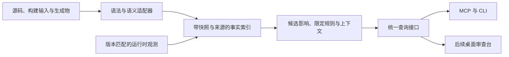

# Semweft 架构设计

> 本文：整体架构、技术选型、crate 划分与依赖规则。 [返回文档索引](../semweft.md)

## 1. 整体架构

产品数据流分为采集、事实索引、分析、接口和展示五层。编译器/索引器与运行时是独立证据来源；每一层都保留分析范围、版本和诊断。crate 划分与算法候选见本文第 3–5 节，语言接口见[语言与 IDL 支持](language-support.md)第 5 节，避免把产品范围等同于预先完成全部实现。



- **采集**：固定源码和构建输入，运行适配器并收集解析、映射与工具诊断。外部索引器为独立进程，其失败不使旧语义证据继续有效。

- **索引**：保存符号、关系、来源、推导和反向依赖；snapshot_id 固定输入，semantic_epoch 在该快照上推进，同一查询读取固定的版本对。

- **分析**：结构影响生成候选和路径；规则核验只执行已实现规则；上下文按指定 tokenizer 裁剪并保留续查信息。

- **接口**：MCP 和 CLI 共用结构化结果；capabilities 与 index_status 分别提供能力和工作区就绪状态，超时、取消、分页和截断有统一语义。信任与审查提交使用本地控制通道，不作为 MCP 查询工具。

- **展示**：首版输出 CLI/JSON/Markdown；后续桌面端通过公开查询服务访问同一证据。桌面进程与共享索引服务隔离，GUI 故障不能中止其他客户端使用的服务。

首版最小依赖是 Rust 语法、SCIP 导入、Rust 常驻语义路径、存储、受限图遍历、预算选择及 MCP/CLI。全文与向量检索、通用 GQL、WASM 插件、复杂布局和算法独立发布均为后续方向，有实际使用方与基准后再实现。

### 1.1 进程与生命周期（v0.1）

v0.1 正式范围为 Rust：每个用户、每个规范化 Cargo workspace 根目录运行一个 daemon。Go 实验 feature 对单个 go.mod/go.work 根目录复用同一进程契约。daemon 是工作区索引的唯一写入者，负责文件监听、语义任务、快照发布与回收；MCP 和 CLI 经本地 IPC 查询它。多个本地客户端共享索引是首版基础行为，多仓库和远程团队共享分别后置。

|入口|启动与连接|索引与退出行为|
|---|---|---|
|semweft mcp|由 Agent 客户端启动 stdio 桥接进程；桥接连接 daemon，不可用时自动拉起同一 semweft 二进制的内部 daemon 子命令|首次事实查询启用索引与监听；stdio 关闭只释放本客户端连接|
|事实查询 CLI|自动连接或拉起同一工作区的 daemon|按需建立索引，请求结束释放连接；已有快照按查询契约绑定|
|semweft index|经本地控制通道请求全量重新索引，并等待本次任务结果|同时有 MCP 或 watch 客户端时仍使用同一存储和调度器；相同输入的并发重建请求合并|
|semweft index --watch|完成首次重建后持有监听连接|前台持续等待；Ctrl-C 释放连接，其他客户端继续使用 daemon|
|capabilities / status|可以连接或拉起 daemon，读取能力与已保存状态|单独调用不启动索引、构建或语义刷新|

daemon 生命周期独立于客户端，拉起时分离 stdio 与客户端信号处理，日志不写入 MCP 协议流。自动拉起不申请仓库信任；首次事实查询先提供语法索引，L3 仅在用户已授权且工具可用时调度，未满足条件的原因进入 index_status。已启用的监听在 MCP 会话或 index --watch 连接存续期间持续运行。最后一个客户端离开后，daemon 完成已排队任务，再按 daemon.idle_timeout_ms 退出；退出前持久化已发布视图，停止监听并回收子进程。原型默认空闲时间为 60 秒，任务耗时另计。

**存储与 IPC 位置**：workspace_id 由规范化根路径生成，同根目录经符号链接访问时使用同一身份；不同 Git worktree 使用不同身份。以下用户目录遵循平台约定：

|平台|用户缓存目录 CACHE|用户配置目录 CONFIG|
|---|---|---|
|Linux|$XDG_CACHE_HOME/semweft，未设置时为 ~/.cache/semweft|$XDG_CONFIG_HOME/semweft，未设置时为 ~/.config/semweft|
|macOS|~/Library/Caches/semweft|~/Library/Application Support/semweft|
|Windows|%LOCALAPPDATA%/semweft/cache|%APPDATA%/semweft|

- 默认索引位于 `CACHE/workspaces/<workspace_id>/index/`；manifest、已发布分析视图和输入内容随索引持久化。仓库内的 .semweft/baseline.json 仅保存后续架构违规基线。
- 启动与写入锁位于 `CACHE/workspaces/<workspace_id>/daemon.lock`；daemon 在整个生命周期持有 OS 文件锁，客户端通过锁与协议握手协调并发启动，不以 PID 文件存在判断服务存活。index.directory 被覆盖时，实际索引目录还须持有独占写入锁，拒绝其他工作区同时打开。
- Unix socket 位于 `CACHE/workspaces/<workspace_id>/daemon.sock`；超出平台路径长度时使用用户私有临时目录 `semweft-<uid>/<workspace_id>.sock`，并把实际端点记入 daemon.lock。Windows 使用仅允许当前用户访问的命名管道 `\\.\pipe\semweft-<user_id>-<workspace_id>`。目录、socket 和锁文件限制为当前用户访问。
- IPC 握手核对工作区身份与协议版本；不匹配返回 daemon_incompatible，连接或启动失败返回 daemon_unavailable。客户端只有取得启动锁并确认旧服务不可达后才清理遗留端点。
- 信任记录位于 CONFIG/trust.json，由 CLI 控制操作维护，按规范化仓库路径与仓库身份登记。仓库配置与索引缓存不提供授权。

多个 MCP 桥接各自维护 stdio 会话、请求取消与分页游标，daemon 统一调度共享刷新。取消或退出一个客户端只影响它的请求。daemon 意外退出时，客户端结束未完成请求；下一次调用重新连接或拉起，首页查询可重试，丢失的分页或续算状态返回 cursor_expired。已持久化且未回收的快照和分析视图可继续固定；恢复后的最新查询先核对磁盘输入，离线期间的变化按新快照发布，旧快照仍对应原输入。快照保留策略见[核心概念与证据模型](evidence-model.md)第 3 节。

### 1.2 v0.1 配置规范

semweft init 在工作区根目录生成 semweft.toml；默认根目录为命令当前位置所属的 Cargo workspace，启用 Go 实验 feature 时也可识别 go.mod/go.work，尚未识别时为当前位置。已有配置保持不覆盖。下例为首版最小配置，数值默认值待原型测量后锁定：

```toml
schema_version = "0.1"

[workspace]
root = "."
exclude = ["target/**", ".git/**", ".semweft/**"]
respect_gitignore = true

[index]
dependency_depth = 0
# directory 默认使用用户缓存目录，按 workspace_id 隔离

[context]
tokenizer = "estimated"

[daemon]
idle_timeout_ms = 60000
```

|字段|类型与默认值|语义|
|---|---|---|
|schema_version|string，"0.1"|必填；未知版本或字段返回 invalid_argument，避免静默忽略配置|
|workspace.root|string，"."|相对 semweft.toml 所在目录解析；Rust 纳入一个 Cargo workspace 及成员，Go 实验纳入一个 go.mod/go.work 范围，额外仓库配置后置|
|workspace.exclude|string 数组，如上例|相对 workspace.root 的 glob 排除规则；显式数组替换默认数组，.git、Semweft 缓存目录始终排除|
|workspace.respect_gitignore|bool，true|在显式排除之外应用 Git 忽略规则；未跟踪且未忽略的源码纳入快照|
|index.directory|string，默认 `CACHE/workspaces/<workspace_id>/index`|可覆盖缓存位置；相对路径以 workspace.root 为基准，目录内容始终从摄取范围排除|
|index.query_cache_views / query_cache_bytes|非负整数，8 / 67108864|查询 LRU 的数量和估算权重双预算，0 可禁用缓存；活跃读者和刷新根不计入缓存预算|
|index.retain_snapshots|可选非负整数，默认不回收|保留最近 N 个语法快照，额外保护 latest、语义基线、固定版本及活跃读者|
|index.cursor_cache_count / cursor_cache_bytes|非负整数，256 / 67108864|分页游标数量与估计字节预算，共享载荷只计一次；600 秒过期，超限淘汰最早游标，单个结果超限返回 cursor_expired|
|index.max_disk_bytes|可选非负整数，默认无限|刷新后按物理大小回收可选历史，必要根超标时保留并报告 budget_unmet；可用 snapshots gc --dry-run 预览|
|index.dependency_depth|非负整数，0|Rust 中 0 只索引 workspace 成员源码，保留外部符号身份；n 纳入 Cargo 已解析依赖图上至多 n 跳的依赖源码。工具链为解析而加载依赖不等于纳入其源码分析；缺失源码或工具限制列入 known_gaps。Go 实验仅支持 0，其他值返回 capability_unsupported|
|context.tokenizer|string，"estimated"|默认估算；也可指定 capabilities 公布的 tokenizer ID（含版本）。请求或 --tokenizer 覆盖此默认值；未知 ID 使用估算并说明原因|
|daemon.idle_timeout_ms|正整数，60000|最后一个连接离开且任务完成后的空闲退出时间，属于运行参数|

实现说明：Rust 的正依赖深度通过已授权的 `cargo metadata --offline --locked` 获取依赖图，缓存元数据并校验成员与依赖 manifest；源码使用虚拟路径纳入快照，磁盘映射仅供后端位置转换与监听。不会自动下载缺失的依赖；不可解析、缺失源码与符号链接列入诊断。工作区外依赖与 Go 成员通过 500ms 元数据核对补充根目录的原生事件监听。

命令的 `--workspace <root>` 用于选择工作区，`--config <path>` 用于选择配置文件；两者同时指定时解析出的根目录必须一致，否则 invalid_argument。未指定配置时从 --workspace 指定目录或命令当前位置向上查找最近的 semweft.toml，再回退到 Cargo workspace（或已启用的 Go 实验项目）与内建默认值；相对 --config 路径以命令当前位置为基准。字段优先级为单次查询参数或对应 CLI 标志 > 工作区配置 > 内建默认值，v0.1 不提供用户级分析配置覆盖。MCP 的工作区与配置在桥接进程启动时选择，同一 daemon 只使用一份生效的分析配置。

源码范围、依赖深度和默认 tokenizer 属于分析输入，变更后发布新 manifest 与 snapshot_id；空闲时间与缓存位置属于运行配置，不改变分析身份。范围变更由 daemon 校验并重新索引；空闲时间在线生效，缓存位置变化在 daemon 停止后由下一次启动采用，旧缓存不自动迁移。客户端传入与当前生效配置冲突的分析配置时返回 config_conflict，并提示使用当前配置或等所有客户端退出后重连。v0.3 的 architecture 规则字段见[功能规格](features.md) F 节，v0.1 不接受这些字段。

---

## 2. 技术选型

|领域|选型|说明|
|---|---|---|
|语法解析|tree-sitter|多语言、增量、容错|
|语义索引|SCIP 批量导入 + 常驻语义后端按需查询|SCIP 用于冷启动与后续 CI 共享索引；Rust 后端评估 LSP 与内嵌 ra_ap_*，接入方式及进程隔离独立验证，见语言支持第 5 节|
|Git|gitoxide|纯 Rust，读取历史和 diff 性能好|
|全文检索|tantivy|BM25，嵌入式；随混合检索引入，不进入 v0.1|
|向量检索|评估 fastembed-rs 或 candle 加 HNSW|后续可选；需固定权重与 tokenizer，并说明原生运行时依赖和首次下载|
|图存储|评估紧凑邻接表与 redb；RocksDB 为可选候选|比较快照、增量写入、内存和查询基准后决定；不预设自研更快|
|并发与异步|rayon（批量解析），tokio（服务）|CPU 密集和 IO 密集分开|
|文件监听|notify|跨平台|
|MCP|官方 Rust SDK（rmcp）|v0.1 仅交付 stdio 桥接；SDK 的 Streamable HTTP 能力在后续按需求评估，与团队版 HTTP API 分别排期|
|CLI 和后续 TUI|clap；后续评估 ratatui|首版只交付 CLI|
|桌面端|评估 gpui-kit；gpui-rsx 为可选候选|先验证列表、规则与代码视图，图视图后续自绘|
|Python 绑定|后续评估 PyO3、maturin|按真实集成需求排期，不进入首版|

**桌面选型门槛**：gpui-kit 与 gpui-rsx 是候选，交付前固定仓库、版本和平台矩阵，验证输入、代码浏览、列表与布局性能。维护人数和支持平台需按选定版本核实，不以未经核查的人数判断作为事实。核心视图先验证 gpui-kit 原生写法，gpui-rsx 仅在有明确收益时引入；桌面端只访问公开查询服务，不拖延引擎、CLI 和 MCP。

---

## 3. crate 划分

`semweft-query` 已实现为可嵌入的查询与刷新服务，CLI/daemon/MCP 共用这一实现，传输层留在 CLI。直接嵌入时宿主负责进程级独占写锁及退出时 `Engine::shutdown`，见[库说明](../crates/semweft-query/README.md)。

以下 crate、算法与接口方向用于技术评审，不构成首版必须交付的工程清单。实现应从最小查询闭环演化，只抽取已有使用方需要的模块。

当前 `semweft-store` 实现不可变视图索引与内容寻址持久化，使用 `semweft-storage` 的模型和后端接口；`semweft-protocol` 提供工具 schema、参数校验、错误与 IPC 请求。daemon 按需加载历史、以增量日志和检查点发布目录，并支持持久化 pin 和安全 GC；查询缓存同时受数量与估算字节预算约束。`semweft-bench` 独立提供真实输入测量，CLI 注入采集、解析及恢复子进程适配。格式兼容、保留策略与测量边界见[底层基础实现](foundations.md)。

```text
semweft/
├── 基础层（不依赖任何 semweft crate，两者互不依赖）
│   ├── semweft-shared       # 多个 crate 共用的基础设施：错误码、ID、Span、路径、哈希、取消令牌
│   └── semweft-algo         # 与代码领域无关的通用算法：图算法、布局、排名融合、预算选择、相似度
├── semweft-core             # 数据模型：Symbol、Edge、Evidence、Snapshot
├── semweft-parse            # tree-sitter 解析与增量更新
├── 语言前端
│   ├── semweft-lang-api     # LanguageFrontend trait；只依赖 core/shared 等抽象基础
│   ├── semweft-lang-common  # 语言前端之间共享：作用域栈、导入解析框架、tree-sitter 查询辅助
│   ├── semweft-lang-rust    # Rust
│   ├── semweft-lang-go      # Go
│   ├── semweft-lang-ts      # TypeScript 与 JavaScript（共享部分基础设施，语言规则分项实现）
│   ├── semweft-lang-python  # Python
│   ├── semweft-lang-java    # Java 与 Kotlin（P1）
│   ├── semweft-lang-cpp     # C 与 C++（P2）
│   ├── semweft-lang-csharp  # C#（P2，后续）
│   └── semweft-langs        # 语言注册表，用 feature 选择编入哪些语言
├── semweft-scip             # 统一导入 SCIP 索引，不按语言拆分
├── semweft-build            # 跨语言构建系统：Bazel、Buck2、compile_commands.json
├── IDL
│   ├── semweft-idl          # 公共契约模型与兼容性规则
│   ├── semweft-idl-thrift   # Thrift 解析
│   └── semweft-idl-proto    # Protobuf 解析（后续新增 OpenAPI、GraphQL）
├── semweft-protocol         # 公共查询与 IPC 契约
├── semweft-storage          # 持久化模型与后端接口
├── semweft-store            # 查询索引与内容寻址存储
├── semweft-query            # 可复用查询、快照绑定、刷新与语言适配
├── semweft-bench            # 独立的存储与查询测量
├── semweft-analysis         # 影响分析、架构规则、度量、契约兼容性（发布编排为后续能力）
├── semweft-context          # 上下文包构建与 Token 预算裁剪
├── semweft-mcp              # MCP Server
├── semweft-cli              # 命令、daemon IPC、MCP 和测量宿主（TUI 后续）
├── semweft-daemon           # 常驻服务、文件监听、多客户端共享；本地信任和审查控制
├── semweft-server           # HTTP / gRPC API（团队版）
└── semweft-desktop          # 桌面审查台（gpui-kit；gpui-rsx 可选）
```

**语言为什么拆成独立 crate**：每种语言的 tree-sitter 语法文件（parser.c）体积大，编译慢；各语言语法的升级节奏不同；各语言的错误诊断应独立；crate 拆分本身不提供进程崩溃隔离，原生解析器故障需另行评估进程或沙箱边界；社区贡献者只需要关注一个 crate；测试可以按语言独立运行。拆分按名称解析和类型系统是否相同来划分，TypeScript 和 JavaScript、C 和 C++ 可以共享适配基础，但名称解析与类型差异必须分别实现并验收；crate 合并不表示语言规则相同。SCIP 格式和语言无关，统一由 semweft-scip 导入；Bazel 这类跨语言的构建系统放在 semweft-build。

## 4. 分层与依赖规则

依赖层次从基础到入口依次为：基础层（semweft-shared、semweft-algo）、数据模型（semweft-core）、抽象与引擎（lang-api、idl、parse、store、analysis 等）、领域内共享（lang-common）、具体语言和 IDL 实现，最上面是产出二进制的入口 crate。

- **语言 crate**只能依赖 semweft-core、semweft-lang-api、semweft-lang-common 以及基础层，语言 crate 之间不能互相依赖

- **事实与算法层**（core、store、algo）不依赖具体语言；当前 **semweft-query** 作为应用服务组合语言前端、采集和查询，Go/Web 由 feature 选择。后续 lang-api / semweft-langs 注册表仍是演进方向，尚未实现。

- **semweft-desktop** 的服务接入方向是依赖 semweft-protocol 的公开协议类型及基础层，作为独立进程经本地 IPC 查询；不链接 semweft-query 的采集、语言和存储实现。当前预览的实际依赖以其 Cargo.toml 为准。

- **semweft-shared 和 semweft-algo** 不依赖任何 semweft crate，两者之间也不互相依赖

- 已实现模块的依赖规则计划通过 CI 检查；未实现模块和检查脚本不视为已有能力

## 5. semweft-shared 与 semweft-algo

两者都在最底层，但入库标准不同：semweft-shared 看是否有多个 crate 共用，semweft-algo 看是否为已使用的通用算法，不提前为未来功能实现或独立发布。

**当前实现**：`semweft-shared` 已统一 core 与桌面端的内容哈希、源码坐标校验及 UTF-16 换算；`semweft-algo` 已提供有序邻接表和受限广度遍历，并接入调用图与候选影响分析。两者均无其他 Semweft 依赖；core 重导出原有基础 API。具体边界、验证与后续顺序见[底层基础实现](foundations.md)。下文 budget、interval 和其他算法仍为计划。

|维度|semweft-shared|semweft-algo|
|---|---|---|
|定位|多个 crate 共用的基础设施|与代码领域无关的通用算法|
|入库标准|至少 2 个 crate 在实际使用|已有实际使用场景且确为通用算法；单独发布后续决定|
|判断方法|去掉它，是否会有多个 crate 各写一份|描述它时，能否完全不提代码、符号、IDL|
|依赖|不依赖任何 semweft crate，不含业务类型；重依赖用 feature 隔离|只依赖泛型和 trait（如 GraphView），不依赖 semweft-shared|
|副作用|可以做 IO、打日志、提供异步辅助|不做 IO、不打日志，结果确定|
|内容|错误基础类型和错误码、字符串驻留、FileId 等 ID 类型、Span、行号索引、UTF-8 和 UTF-16 偏移换算、跨平台路径规范化、内容哈希（blake3 或 xxhash）、取消令牌、rayon 和 tokio 辅助函数、tracing 初始化、Token 计数|候选模块见下表；首版只实现 graph 中的受限遍历与可达性、budget 和 interval|
|发布|只在 workspace 内部使用|稳定后可以单独发布到 crates.io|

命名用 shared 而不用 shard，避免和索引分片（shard）混淆。

### 5.1 semweft-algo 模块

下表是候选清单，不是首版工程范围。首版只实现 graph 的受限遍历与可达性、budget 和 interval；其余模块在对应使用方立项时引入。

|模块|算法|主要使用方|
|---|---|---|
|graph|Tarjan 强连通分量、拓扑排序、带上限的路径枚举、可达性、支配树、最小反馈弧集近似、PageRank、中心度|analysis（循环依赖、发布顺序、影响范围）、context（仓库地图排序）|
|layout|Sugiyama 分层布局、力导向布局|desktop（调用图、服务拓扑），以后的 Web 审查视图也复用|
|rank|倒数排名融合（RRF）|query（合并全文、向量、图检索的结果）|
|budget|背包问题的贪心近似|context（按 Token 预算选择内容）|
|similarity|MinHash、SimHash|analysis（重复代码检测）|
|tree_diff|GumTree 风格的树匹配|analysis（语义 diff，区分重命名、移动和修改）|
|interval|区间树|store（按源码位置查找符号）|

### 5.2 算法和业务规则的边界

|算法放 semweft-algo|业务规则放 semweft-analysis 或 semweft-context|
|---|---|
|拓扑排序|按兼容策略、混合版本与部署元数据建立阶段约束；缺少前提时只给条件建议|
|强连通分量|检测粒度：按 crate、模块还是服务检测循环依赖|
|背包选择|内容优先级：定义 > 调用方签名 > 相关测试|
|无|风险评分公式，全部放在 semweft-analysis|

**semweft-shared 防变质规则**

- 至少 2 个使用方才能入库，不提前抽象

- 重依赖必须用 feature 隔离，避免拖慢所有 crate 的编译

- 模块变大，或只剩一个使用方时，移回使用方或拆出去

- 禁止 utils.rs、misc.rs 这类模块名

**semweft-algo 防变质规则**

- 结果必须确定：不依赖 HashMap 遍历顺序，分数相同时按稳定键排序，对应产品“结果可复现”的原则

- 只依赖 trait，不出现 Symbol、Edge 等业务类型

- 已实现算法按风险和性能需求选择性质测试与基准；未使用的算法不提前实现

- petgraph 已有的算法直接包一层，不重复实现
