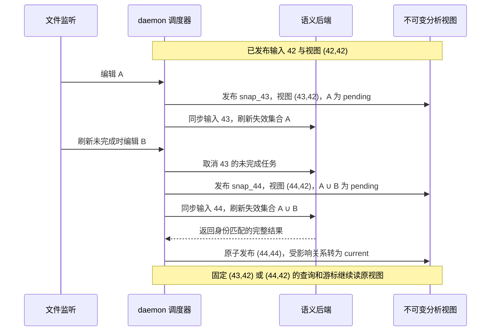

# Semweft 核心概念与证据模型

> 本文：所有接口、功能和视图共用的概念、证据维度与快照语义。 [返回文档索引](../semweft.md)

## 1. 核心概念

|概念|说明|示例|
|---|---|---|
|Workspace 工作区|一次分析的范围；v0.1 为一个 Cargo workspace，多仓库后续扩展|一个 Cargo workspace 及其成员|
|Snapshot 快照|固定源码、构建输入与分析配置的版本；snapshot_id 绑定这些输入及 syntax_epoch，不包含可推进的 semantic_epoch，见第 3 节|不透明 snapshot_id + 不可变 manifest；响应另带 epochs|
|Manifest 输入清单|快照的不可变输入记录，包含文件内容、revision、构建条件、依赖、生成物与分析版本，见 3.1 节|源码 file_hash、Cargo features、Cargo.lock 哈希|
|Epoch 版本序号|syntax_epoch 标识已发布输入状态；semantic_epoch 标识该快照已完成语义刷新所覆盖的输入版本，见 3.2 节|输入为 43，语义仍覆盖到 42|
|版本对|一次查询绑定的 (syntax_epoch, semantic_epoch)，与 snapshot_id 一起固定读取范围，见 3.4 节|(43,42) 或 (43,43)|
|分析视图|某个 snapshot_id 与版本对对应的不可变语法事实、关系证据及范围声明；刷新只发布新视图|snap_43 的 (43,42) 视图仍可分页读取|
|Symbol 符号|函数、方法、类型、trait、interface、字段、常量、模块，以及 IDL 中的结构体、字段、枚举、RPC|order::service::create_order|
|Edge 关系|符号之间的关系：定义、引用、调用、实现、继承、导入、字段读写、RPC 调用|order::service::create_order 调用 inventory::Stock::deduct|
|relation_id / evidence_id|分别标识关系与单条来源证据；同一快照内按 2.1 节的身份规则区分，跨视图比较需携带来源版本|同一调用关系 rel_1 挂 L1 的 ev_1 与 L3 的 ev_2|
|Evidence 证据|关系的来源、确定性、运行时观测、新鲜度和推导规则，见第 2 节|L3 来源 + candidate + current + observed|
|Completeness 范围声明|查询绑定视图的分析范围、已知缺口和 pending 单元，见 2.2 节；输出截断另记于 output|partial，附解析失败与待刷新单元|
|Frontier 遍历前沿|图查询中尚未展开的边界符号；可作为扩大预算或深度后的续查起点，见接口规格第 1.2 节|达到 depth=3 时仍有后继的符号|
|Service 服务|由 IDL 和部署元数据识别出的服务节点|order-service|
|Contract 契约|服务对外暴露的 RPC、结构体、字段和枚举|inventory.thrift 中的 DeductRequest|
|Context Pack 上下文包|为 Agent 生成、按 Token 预算裁剪的相关代码和结构信息|20k Token 内的定义、调用方签名、相关测试|

---

## 2. 证据模型与分析边界

### 2.1 关系证据

证据来源不等于正确率，也不等于运行时目标唯一。关系与证据分开标识：relation_id 由关系类型、两端符号和源码位置（调用点或引用点）决定，同一快照内稳定；一条关系挂一条或多条证据，每条证据有独立 evidence_id，并保留来源、索引器版本、构建条件及推导规则。同一调用被 L1 与 L3 同时发现时是一条关系、两条证据。查询按以下维度分别统计，禁止压成一个最高精度分数。

|维度|取值|含义|
|---|---|---|
|source|L1 / L2 / L3|L1 为语法与名称启发式；L2 为轻量名称解析和类型推断；L3 为编译器或语义索引支持的绑定信息|
|certainty|definite / candidate|definite 表示在声明的配置和模型内目标已解析；candidate 表示可能目标，候选集合未必穷尽|
|runtime|observed / not_observed / unavailable|observed 只表示在标注的环境、版本和观测窗口中发生过；未观测不能证明不会发生|
|freshness|current / pending / stale|current 表示已验证适用于查询绑定的源码与构建输入，包含未受编辑影响而复用的证据；pending 表示已失效、等待刷新，可附上一语义版本的结果供参考；stale 为主查询快照之外的历史证据，v0.1 通过 find_references 的 include_stale 与 stale_from 显式请求，独立返回于 history，见接口规格第 1.3 节|

**关系级取值与统计口径**：source 属于单条证据，统计时按证据计数，一条关系可被多个来源各计一次；certainty、freshness、runtime 按关系计数。关系的 certainty 在存在 definite 证据且无冲突证据时为 definite，证据冲突时按 candidate 计并列为诊断；freshness 取其证据中最差者（stale 劣于 pending，pending 劣于 current）；任一证据 observed 即为 observed。调用方数、服务数等按符号去重，与关系数、证据数分别报告。

**冲突的定义**：只比较同一源码位置、关系类型、构建条件和查询版本对上的绑定断言。两条证据支持同一目标时，certainty 或 source 不同不构成冲突，因此同一关系的 L3 definite 与 L1 candidate 可以合并为 definite。不同目标也不自动构成冲突：动态分发的多个候选可以并存。只有绑定断言互不兼容时才记为冲突，例如两个索引器分别将同一静态调用唯一绑定到不同符号。由于目标不同会产生不同 relation_id，冲突检测按调用点或引用点分组；诊断列出冲突的 relation_id、evidence_id 和原因，相关关系均降为 candidate。不同构建条件或历史版本的差异分开记录，不混作当前证据冲突。

例如 dyn Trait 调用可以是 source=L3、certainty=candidate；一次执行观察到某实现，只增加 runtime=observed，不删除其他静态候选。普通行覆盖率不提供调用边或测试身份；需要逐测试采集才能建立测试映射。OpenTelemetry 只支持有埋点的 span，函数级关系需要专门的插桩或追踪，并与源码版本对应。

**SCIP 的边界**：SCIP 提供 occurrence、符号信息及部分符号关系，不是完整的调用图。将语义引用与语法调用点对齐后，可生成有 L3 证据支持的调用边，但仍须按语言规则判断 certainty；宏、重载、动态分发和位置映射失败要分别诊断。对齐本身不构成准确率证明。L3 表示语义证据来源，不是对整体正确性或完整性的认证。

### 2.2 范围声明与核验结果

每个查询包含 completeness，说明分析范围、已知缺口和尚未刷新的单元；分页、路径限制和上下文预算造成的输出缺省另放在 output 字段。范围声明可以披露已知未知，不能承诺识别所有未知遗漏。

|字段|作用|
|---|---|
|scope|仓库与文件集合、语言、构建配置、依赖边界、外部消费者是否纳入|
|status|within_scope / partial / unknown；within_scope 仅表示声明范围内的受支持分析已完成，不代表整个系统完整|
|known_gaps|解析失败、未解析引用、未建模动态机制、缺失依赖或生成物|
|pending_units|因依赖失效而等待语义刷新的文件、包或项目|
|output（响应顶层）|是否分页或截断、截断原因、限制参数、已返回与剩余结果（未知时为 null）及续查方式，见[接口规格](interfaces.md)第 1.2 节|

**status 判定**：声明范围内的受支持分析全部完成，且 known_gaps 与 pending_units 均为空时为 within_scope；存在任一 known_gaps 或 pending_units 时为 partial；分析范围本身无法确定（如构建配置识别失败、首次索引未完成）时为 unknown。within_scope 不与非空 known_gaps 同时出现。

影响图表示候选影响，不直接判断每个调用方是否必须修改。verify_change 核验明确声明的规则，返回 findings 和规则版本，每条规则单独返回三个状态之一：violations_found（发现违规）、no_violations_found（声明范围内未发现违规）、insufficient_evidence（证据不足）。整体结果取最严重者：任一规则 violations_found 则整体为 violations_found；否则任一 insufficient_evidence 则整体为 insufficient_evidence；全部规则为 no_violations_found 时整体才为 no_violations_found。未运行的规则和缺失证据必须列出；行为正确性仍需依靠需求、编译器、测试或人工证据。人的批准作为独立审查记录，不提升关系 certainty 或消除分析缺口。

### 2.3 承诺边界（所有文档适用）

以下约束适用于所有文档中的功能、接口和视图，其他文档只在有特殊含义时重复：

1. 来源等级（L1/L2/L3）表示证据来源，不代表正确率或完整性

2. candidate 集合未必穷尽；runtime=not_observed 不证明不会发生

3. within_scope 与 no_violations_found 只针对声明范围和已运行规则，不证明行为正确，也不覆盖未知消费者

4. 分页省略的内容可在同一快照按游标续查；超时、深度或节点上限中断的计算标明统计是否精确，并给出续算游标或重查参数；上下文预算省略项列出位置和续查入口。截断不等于分析完整

5. 人工批准是独立审查记录，不改变关系 certainty 或分析缺口

6. 文中的性能、质量和效果数字均为待基准验证的目标；实验性语言、规则和框架适配按实际能力声明

精确 Token 模式保证最终序列化响应不超预算；估算模式只保证公布的估算值不超预算，实际计数的偏差另行评测。本文集中定义分析承诺边界，各文档保留其特有的输入校验、状态转换与执行要求。

---

## 3. 快照与编辑一致性

### 3.1 输入身份

snapshot_id 绑定不可变 manifest 与 syntax_epoch。manifest 包含纳入的源码内容（含未提交与未跟踪文件）、各仓库 revision、target/features/build tags、依赖锁定与解析结果、生成器及生成物哈希，以及索引器、规则与分析配置版本。semantic_epoch 只记录语义完成进度，不参与 snapshot_id。manifest 可通过 index_status 查询；无法固定的外部输入列为不可复现因素。

每次发布新的源码、构建或分析输入，都分配新 syntax_epoch 与 snapshot_id，包括注释与格式变化。文件监听可以合并未发布的连续编辑；忽略文件、重复事件和发布前已恢复原状的编辑不生成快照。语义补齐保持原输入身份。索引过程中发现新依赖或生成物时，先发布新快照再分析，旧 manifest 保持不变。

### 3.2 版本与原子发布

syntax_epoch 在工作区内从 1 起单调分配；尚无已完成语义版本时 semantic_epoch=0。semantic_epoch 以已完成语义刷新的输入版本表示：(43,42) 表示输入 43 仍有单元 pending；(43,43) 表示声明范围内已启用的语义分析完成。known_gaps 独立披露。无需重算的编辑（如只改注释）在验证证据可复用后直接推进。

v0.1 每个版本对对应一份不可变分析视图。刷新中间结果先暂存，所有失效单元完成后原子发布新 semantic_epoch 视图。此前受影响的关系保持 pending，并附原始源码版本与失效原因；已验证可复用的关系为 current。同一 snapshot_id 可先提供 (43,42)，随后提供 (43,43)，已绑定旧版本对的查询与游标继续读取原视图。相同输入的显式重建复用快照；已有版本对的结果经一致性校验后复用，差异列为诊断，不覆盖已发布视图。

### 3.3 编辑、失效与连续刷新

编辑先使本文件语义证据及可能受影响的跨文件引用失效。导出、类型和实现集合变化沿反向依赖传播；构建、依赖和生成器变化按项目或工作区失效，范围不明时扩大失效集合。新快照以最近完成版本为基线，连续编辑时合并此前未完成的失效单元。

下图从已完成的 (42,42) 开始。编辑 B 到达时，43 的刷新尚未完成；44 继承两次编辑的失效集合，完成后统一发布：

语法事实与语义证据分别刷新。批量 SCIP（包括 rust-analyzer scip）用于冷启动、后续 CI 共享索引、校准及无常驻路径时的项目重建；编辑期优先由常驻语义后端按需查询。两条路径的刷新耗时分别测量。

### 3.4 查询绑定与新鲜度等待

查询在执行前确定版本对，计算与分页始终读取该视图。新鲜度等待发生在版本对确定之前：

|模式|触发|版本对如何确定|require_fresh=true 的含义|
|---|---|---|---|
|固定快照|传入 snapshot_id，未传 semantic_epoch|syntax_epoch 取该快照的值；semantic_epoch 取确定版本对时该快照最新的已发布视图|等待该 syntax_epoch 的语义刷新完成，成功后可从 (43,42) 选择到 (43,43)；若已被新编辑取代且刷新被取消，则立即停止等待|
|最新可用|未传 snapshot_id|查询开始时的最新版本对|等待最新 syntax_epoch 的语义刷新完成；等待期间又有编辑时跟随最新版本，直到 current 或超时，以等待结束时的最新版本对执行|

显式传入 snapshot_id 和 semantic_epoch 可固定既有分析视图；该视图 pending 时不等待或替换版本，require_fresh=true 返回 reason=version_pinned。分页游标也总是沿用首页的版本对，续页忽略 require_fresh 和 fresh_wait_ms。绑定的版本对在等待结束后确定；等待受 fresh_wait_ms 与请求总 timeout_ms 约束，预算分配见[接口规格](interfaces.md)第 1.3 节。

响应的 epochs 返回实际版本对，fresh_requirement 记录要求与等待结果，例如 { "requested": true, "satisfied": false, "reason": "timeout", "waited_ms": 2000 }。reason 取 timeout、superseded、refresh_failed 或 version_pinned；满足要求或未请求时为 null。satisfied 根据该视图是否还有 pending 单元填写，与 completeness 分开。新鲜度未满足时，查询仍可在剩余总预算内返回结果；计算耗尽预算时返回已完成部分，尚无结果时返回 timeout 错误。预算时间线见[接口规格](interfaces.md)第 1.3 节。

### 3.5 保留与服务恢复

daemon 默认保留全部已发布历史；配置 `index.retain_snapshots` 或执行 `snapshots gc --keep-last N` 后，额外保护 latest、最后一个可用语义基线、未完成查询持有的视图，以及通过 `snapshots pin` 显式固定的版本对（如审查用的 base/head）。分页保存完整结果，游标本身不固定磁盘版本；跨后续查询使用历史版本时应显式 pin。数量/估算字节 LRU 只管理内存查询缓存，磁盘字节上限策略尚未实现。指定快照或视图已回收时返回 snapshot_expired；游标状态失效时返回 cursor_expired，均附重查提示。正常退出持久化已发布视图，进程重启后的输入核对、游标失效与恢复见[架构设计](architecture.md)第 1.1 节。
