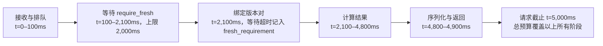

# Semweft 接口规格

> 本文：MCP、CLI、查询语言与外部集成。 [返回文档索引](../semweft.md)

## 1. MCP Server（第一优先级）

Agent 通过 MCP 调用 Semweft。事实查询工具返回结构化 JSON，统一包含 schema_version、snapshot_id、epochs、fresh_requirement、evidence_summary、completeness 和 output，关系类工具另含 relations。capabilities、index_status 和 get_review_result 的响应字段分别见 1.5、1.6 节。跨查询以 snapshot_id 固定输入，以 snapshot_id + semantic_epoch 固定同一分析视图；分页游标绑定版本和参数，过期时返回重查提示。版本对的确定方式见[核心概念与证据模型](evidence-model.md)第 3 节。

**统一调用语义**：每个工具声明 JSON Schema 入参；通用参数与默认值见 1.3 节。错误以 schema_version 与结构化 error 返回，至少区分 invalid_argument、symbol_not_found、ambiguous_symbol、file_not_found、content_mismatch、budget_too_small、snapshot_expired、cursor_expired、timeout、cancelled、indexer_unavailable、capability_unsupported、daemon_unavailable、daemon_incompatible、config_conflict、internal_error；审查查询另可返回 review_not_found。桥接可在 daemon 不可达时返回结构相同的传输诊断。超时返回已完成部分，按 1.2 节标注统计精度与续查方式；只有尚无任何可返回结果时才返回 timeout 错误。CLI 本地控制错误与退出码见第 2.1 节。工具数量与描述长度计入 Agent 的上下文成本，按[质量目标与评测](quality.md)第 2 节的 Token 口径统计。

|工具|作用|首个版本|
|---|---|---|
|capabilities|工具、语言、来源、规则与 tokenizer 的支持状态及运行要求|v0.1|
|index_status|工作区当前索引进度、快照 manifest、pending 单元与信任状态|v0.1|
|repo_map|模块、已识别入口、核心符号及 crate/模块依赖的结构摘要|v0.1|
|search_symbols|名称、路径和类型检索；全文与语义检索后续增加|v0.1|
|symbol_at|从文件位置解析声明或引用目标，返回符号与候选证据|v0.1|
|get_symbol|签名、文档、位置和可选函数体|v0.1|
|find_references|声明范围内引用，按来源、确定性和类型分组|v0.1|
|call_graph|受深度、节点数和时间预算约束的调用关系|v0.1|
|impact_of|符号或 diff 的候选影响和证据路径；风险评分后续增加|v0.1|
|context_pack|按符号或候选任务目标和 Token 预算打包上下文|v0.1|
|verify_change|按已实现规则核验；列出 findings 和证据不足|v0.2|
|find_paths|受限制的调用路径，显式报告截断|v0.2|
|find_implementations|trait 或 trait 方法的已索引实现，标注测试作用域与外部实现缺口|v0.2|
|get_review_result|按 review_id 拉取绑定快照、版本对和 diff 哈希的人工审查记录|v0.3|
|arch_check|已实现架构规则检查|v0.3|
|contract_impact|已建模 IDL 变更的代码影响；发布建议后续增加|v0.4|
|query|结构化高级图查询，语法待定|后续|

上表同时列出已接入与未来规划。当前注册 11 个只读工具：v0.1 的 10 个工具加 `find_implementations`。本次 v0.2 增量只接入 `find_implementations` / `impls`，`verify_change`、`find_paths` 及其他未来工具尚未接入；不能根据“首个版本”列推断整版能力已交付。

### 1.1 响应示例

下例为 impact_of 的示意响应，不是基准结果。

```json
{
  "schema_version": "0.1",
  "snapshot_id": "snap_demo_after",
  "epochs": { "syntax": 42, "semantic": 42 },
  "fresh_requirement": { "requested": false, "satisfied": true, "reason": null, "waited_ms": 0 },
  "target": "inventory::Stock::deduct",
  "summary": {
    "direct_callers": 14,
    "transitive_callers": 63,
    "services": null,
    "tests_to_run": null,
    "risk": null
  },
  "evidence_summary": {
    "basis": "complete",
    "exact": true,
    "relation_count": 71,
    "evidence_count": 76,
    "source": { "L3": 66, "L2": 0, "L1": 10 },
    "certainty": { "definite": 64, "candidate": 7 },
    "freshness": { "current": 71, "pending": 0, "stale": 0 },
    "runtime": { "observed": 0, "not_observed": 0, "unavailable": 71 }
  },
  "completeness": {
    "status": "partial",
    "scope": {
      "workspace_id": "ws_demo",
      "languages": ["rust"],
      "build_config_hash": "cfg_demo",
      "external_consumers_included": false
    },
    "known_gaps": [
      { "kind": "unresolved_dispatch", "callsite_count": 2, "reason": "dyn StockStore 的候选集合无法证明穷尽" }
    ],
    "pending_units": []
  },
  "relations": [
    {
      "relation_id": "rel_0001",
      "kind": "call",
      "from": "order::service::create_order",
      "to": "inventory::Stock::deduct",
      "location": { "file": "order/src/service.rs", "line": 88, "column": 12, "file_hash": "fh_demo_01" },
      "certainty": "definite",
      "freshness": "current",
      "runtime": "unavailable",
      "evidence": [
        { "evidence_id": "ev_0001", "source": "L3", "certainty": "definite", "derivation": "scip_reference+syntax_callsite", "indexer": "rust-analyzer-scip@demo" },
        { "evidence_id": "ev_0002", "source": "L1", "certainty": "candidate", "derivation": "syntax_callsite+name_match", "indexer": "tree-sitter-rust@demo" }
      ],
      "depth": 1,
      "path": ["rel_0001"]
    },
    {
      "relation_id": "rel_0002",
      "kind": "call",
      "from": "order::http::create_order_handler",
      "to": "order::service::create_order",
      "location": { "file": "order/src/http.rs", "line": 41, "column": 9, "file_hash": "fh_demo_02" },
      "certainty": "definite",
      "freshness": "current",
      "runtime": "unavailable",
      "evidence": [
        { "evidence_id": "ev_0003", "source": "L3", "certainty": "definite", "derivation": "scip_reference+syntax_callsite", "indexer": "rust-analyzer-scip@demo" }
      ],
      "depth": 2,
      "path": ["rel_0002", "rel_0001"]
    }
  ],
  "output": {
    "truncated": true,
    "truncation_reason": "page_limit",
    "returned_relations": 2,
    "remaining_relations": 69,
    "continuation": { "kind": "cursor", "next_cursor": "cur_demo_2" }
  }
}
```

**字段说明**：direct_callers 为直接调用方数，transitive_callers 包含直接调用方，是当前模型内的可达集合，二者按调用方符号去重。relation_count 按 relation_id 统计关系（边），同一调用方可经多条边到达，因此与调用方数不同；evidence_count 统计证据条数，一条关系可有多条证据。source 分布按证据计数（各项之和为 evidence_count），certainty、freshness、runtime 按关系计数（各项之和为 relation_count），关系级取值规则见[核心概念与证据模型](evidence-model.md)第 2.1 节。path 按从该关系到目标的顺序列出 relation_id，构成证据路径。示例按分页返回前 2 条，其余用 next_cursor 续查。服务映射在 v0.4 起提供；测试候选和风险评分在 v0.2 起逐项适配，未提供的字段返回 null 并在能力清单说明。null 不表示数量为零。

示例的两条证据都支持 inventory::Stock::deduct，L1 的 candidate 表示较弱的支持，不反驳 L3 的 definite，因此关系可为 definite。互不兼容的目标绑定才按证据模型中的冲突规则处理。

### 1.2 统计精度与截断续查

evidence_summary.basis 说明统计覆盖的范围：complete 表示结果集已完整计算，统计不受分页影响；within_limits 表示在查询声明的深度等限制内完整计算，统计在该口径内精确，限制之外未知；partial 表示计算被中断，只统计已完成部分。exact 仅在 complete 或 within_limits 时为 true。统计不精确时 remaining_relations 为 null，表示未知，不表示零。

|truncation_reason|含义|basis|remaining_relations|续查方式（continuation.kind）|
|---|---|---|---|---|
|page_limit|结果已完整计算，只是分页|complete|精确值|cursor：next_cursor 在同一版本对上续页|
|depth_limit|达到声明的 depth，仍有未展开的边|within_limits|该深度内精确|requery：返回 frontier（未展开的边界符号）；调大 depth 重查，或以 frontier 符号为起点查询|
|node_limit|遍历达到 max_nodes|partial|null|requery：同上返回 frontier 与建议参数|
|timeout|在 timeout_ms 内未完成|partial|null|resume：resume_cursor 从保存的遍历前沿在同一版本对上继续计算，快照回收前有效；或提高 timeout_ms 重查|
|budget|context_pack 预算不足以放入全部内容|complete|—|omitted：省略清单及其分页见[功能规格](features.md) E 节“预算计量”|

多种原因同时出现时，truncation_reason 取对统计精度影响最大者（timeout、node_limit 优先于 depth_limit，再优先于 page_limit），continuation 可同时带 next_cursor 与 resume_cursor。截断只体现在 output，不改变 completeness.status。

### 1.3 已接入的工具契约

以下数值为初始默认值，原型测量后调整，正式值以 JSON Schema 与能力清单为准。

**事实查询通用参数**（管理与审查查询的适用字段见 1.5、1.6 节）

|参数|默认值|说明|
|---|---|---|
|snapshot_id|不传，即最新可用模式|传入则固定快照，见证据模型第 3 节|
|semantic_epoch|该快照最新已发布的值|显式传入时必须同时传 snapshot_id，固定既有分析视图；不存在的值为 invalid_argument，已回收为 snapshot_expired|
|require_fresh|false|是否等待语义刷新；结果见 fresh_requirement|
|fresh_wait_ms|min(2,000, floor(timeout_ms / 2))|新鲜度等待上限，允许为 0；显式值不得超过总预算的一半；require_fresh=false 或固定分析视图时不等待|
|limit|100，上限 1,000|单页返回条数|
|cursor|无|沿用首页版本对和结果参数；timeout_ms 可按页调整，require_fresh 与 fresh_wait_ms 被忽略；其他参数显式传入时须与首页一致，否则 invalid_argument|
|timeout_ms|5,000，上限 60,000|正整数；从服务端接收请求到结果序列化的总预算，包含排队、等待刷新和计算，不含网络传输|
|source / certainty|不过滤|关系类工具可按证据来源和确定性过滤；过滤后的统计按过滤后的结果计算|
|freshness|[current, pending]|关系类工具的关系新鲜度过滤；请求 stale 还须按下方历史证据契约指定来源，支持范围由 capabilities 声明|

**各工具入参与返回**

|工具|必填|可选（默认值）|主要返回|特有错误与状态|
|---|---|---|---|---|
|capabilities|无|timeout_ms（5,000）|能力清单与配置限制，见 1.5 节|不要求已有索引|
|index_status|无|snapshot_id（最新快照）、timeout_ms（5,000）|manifest、已保留版本对、刷新进度与信任状态，见 1.5 节|显式快照已回收为 snapshot_expired|
|repo_map|无|path_prefix（工作区根）、depth（2）、max_symbols_per_module（20）、dependencies（crate，另有 module、none）|modules、entries、core_symbols 及排序依据；dependencies 为结构依赖边，标注来源与确定性，仓库外依赖折叠；v0.1 entries 为 Cargo bin/lib 目标及可定位的 main，框架入口后续；推断类摘要单独标注依据|path_prefix 不在工作区内为 invalid_argument|
|search_symbols|query|kind（全部）、path_prefix、match（fuzzy，另有 exact、prefix）|symbols：symbol_id、限定名、kind、位置与匹配方式|无匹配返回空列表，不返回 symbol_not_found|
|symbol_at|file、line、column|file_hash（可选，调用方预期的文件内容哈希）|occurrence、enclosing_symbol_id、symbols（目标符号与 certainty、evidence），见下文|file_not_found；file_hash 不匹配为 content_mismatch；越界或非 UTF-8 码点边界为 invalid_argument|
|get_symbol|symbol（symbol_id 或限定名）|include_body（false）、include_docs（true）|签名、文档、可见性、所属模块、位置与 file_hash|symbol_not_found；名称对应多个符号时返回 ambiguous_symbol，details 列出候选|
|find_references|symbol|kinds（全部：read、write、call、type、import）、include_stale（false）、stale_from（固定 snapshot_id 与 semantic_epoch）|relations 按 kind 分组，含未解析项；显式请求时另带 history|同 get_symbol；历史视图回收为 snapshot_expired|
|find_implementations|symbol（Rust trait 或 trait_method）|path_prefix（工作区根）、source（全部）、certainty（全部）、freshness（current、pending）及事实查询通用参数|target、trait、mode、implementation_counts、inherited_defaults、excluded_candidates、relations（含 implementation），见下文|同 get_symbol；其他目标 kind 为 invalid_argument；不支持历史证据扩展|
|call_graph|symbol|direction（callers，另有 callees、both）、depth（3，上限 10）、max_nodes（1,000）|nodes、relations、frontier|depth_limit、node_limit 截断见 1.2 节|
|impact_of|symbol 或 diff，二选一|diff 取 base、head（选择器见 1.4 节）、depth（3）、max_nodes（1,000）|summary、changes、snapshots（diff 模式）、relations 与证据路径|两者都传或都不传为 invalid_argument；base 侧无语义索引时降级并列入 known_gaps|
|context_pack|budget，以及 symbol 或 task 二选一|tokenizer（使用工作区配置，默认 estimated）、include（定义、调用方签名、被调方签名、相关类型、测试、配置）|items（粒度为 full、signature、outline 或 location）、token_count、omitted|budget 低于 min_budget 返回 budget_too_small；v0.1 的 task 只按符号名和路径匹配|

实现补充：关系查询支持 `path_prefix`（CLI `--path`），按引用、调用或实现发生位置过滤。`repo_map` 包含空源文件模块、`core_symbols`（按不同入边符号数排序）、`omitted_core_symbols` 与 `analysis_health`；`max_symbols_per_module=0` 表示返回所有模块内符号，人工格式默认采用此值，Agent 默认仍为 20。

#### find_implementations：Rust trait 实现查询（v0.2 增量）

首请求必填 `symbol`，可用 `symbol_id`、唯一名称或限定名；解析结果须为 Rust `trait` 或 `trait_method`。方法目标先解析所属 trait；结构体、普通函数和 impl 方法等其他 kind 返回 `invalid_argument`，目标不存在或不唯一分别返回 `symbol_not_found`、`ambiguous_symbol`。后续页可只传 `cursor` 和可调整的 `timeout_ms`，其他参数遵循上方通用游标契约。

可选参数 `path_prefix` 按实现所在文件过滤，`source` 为 L1/L2/L3 数组，`certainty` 为 definite/candidate 数组，`freshness` 为 current/pending 数组（默认二者）。当前实现查询使用 L1 和已发布的 L3，不产生 L2 证据，不在查询时请求语义后端。`source` 先筛选关系证据，随后按保留的证据重算确定性，再应用 `certainty` 和 `freshness`；统计依据过滤后的关系。`source=["L3"]` 不返回只有名称匹配的 L1 候选，`source=["L1"]` 不保留 L3 带来的 definite。`snapshot_id`、`semantic_epoch`、`require_fresh`、`fresh_wait_ms`、`limit`、`cursor`、`timeout_ms` 均沿用事实查询约定；本工具不支持 `include_stale` / `stale_from`，不能借 `freshness=["stale"]` 请求历史扩展。直接固定历史快照查询时，证据相对于该视图判断新鲜度。

响应沿用公共信封与 `schema_version="0.1"`，增加以下字段：

|字段|含义|
|---|---|
|target|本次解析的 trait 或 trait 方法符号|
|trait|所属 trait 的符号；trait 模式下与 target 指向同一符号|
|mode|`trait` 或 `trait_method`|
|relations|`kind="implements"` 的显式实现关系；trait 模式从 `impl_id` 指向 trait，位置为 impl 头部的 trait 名；方法模式从显式实现方法指向目标 trait 方法，位置为实现方法名|
|relations[].implementation|所属 impl 的 `impl_id`、`trait_path`、`self_type`、`generics`、`unsafe`、`blanket`、`location`、`span` 与 `methods`；location 带 file_hash，methods 列出已索引的直接方法及其 symbol_id、名称、行号和 scope|
|implementation_counts|过滤后完整结果的统计，具体口径见下文|
|inherited_defaults|方法模式下未显式覆盖目标默认方法的 impl；列出 impl 身份、类型、位置、scope 与确定性，单独表示继承默认体的候选，不生成显式实现方法关系；trait 模式为空|
|excluded_candidates|存在可靠的 definite 竞争头部绑定、且无目标绑定时才排除的名称候选，附 impl 身份、位置、实际绑定目标及原因；不属于实现关系；candidate 竞争或确定绑定冲突保留为候选并披露 gap|

关系的 `scope` 为 `production` 或 `test`：trait 模式和默认方法继承项以 impl 的 `block.test_only` 为准，包括已抽取的 `#[cfg(test)]`、`tests/` 等测试作用域；没有方法的标记 trait 或空 impl 也使用这个标记。方法模式与 implementation.methods 的方法项沿用 `test_scope()`。生产 impl 内单个 `#[cfg(test)]` 方法可以标为 test，但不能把整个 impl 或其他方法归为 test。测试作用域是源码分类，不表示测试已运行或覆盖了目标。text / Markdown 输出按相同作用域分组并显示实现统计与默认方法继承项。

`implementation_counts.total` 是**过滤后完整结果中显式实现关系的条数**，trait 模式按 impl 关系计，方法模式只按显式方法实现关系计；`production + test = total`。`with_semantic_evidence` 为其中保留语义证据的关系数，`blanket` 为其中标注为 blanket 的关系数。`inherited_defaults`、`excluded` 分别计对应元数据数组的条目，不加入 total；它们也不加入 `evidence_summary.relation_count`。blanket 标记来自语法启发式，不表示已枚举其适用的具体类型。

**分页与元数据**：只有 `relations` 消费 `limit` 并通过游标分页。`implementation_counts` 和 `evidence_summary` 描述过滤后、分页前的完整显式关系集合，不能随页变化，也不是实现类型数或当前页长度。`inherited_defaults`、`excluded_candidates` 是同一绑定视图与过滤参数下的完整快照元数据，应用适用的路径、来源、确定性、新鲜度过滤后随每页完整返回，不消费 limit、不各自分页；不能跨页累加它们的条目或计数。只有默认方法继承而没有显式覆盖时，允许 total 为 0、relations 为空而 inherited_defaults 非空。`output.returned_relations`、`remaining_relations` 和续页游标只描述显式关系；首页后的编辑和语义刷新不改变该游标绑定的结果。

例如过滤后有 3 条显式实现关系和 2 个默认方法继承项，`limit=1` 时依次返回 3 页：每页 total 都为 3、inherited_defaults 计数都为 2，两项默认继承元数据均在每页返回；三页 relations 的并集才是那 3 条显式关系。

证据推导见[证据模型](evidence-model.md#21-关系证据)：语法名称实际匹配时才附 L1 `syntax_impl_header+name_match`，始终为 candidate；已发布的 L3 头部绑定与方法分派分别以 `impl_header_binding:*`、`impl_dispatch:*` 保留来源。L3 头部绑定可独立识别 `use Trait as Alias` 后的 `impl Alias for Type`，即使语法末段不匹配也可返回；这种仅靠 L3 识别的别名实现不得伪造 L1 name_match，`source=["L1"]` 应将它过滤掉。LSP 证据仍为 candidate，已验证并对齐的 SCIP 绑定可提供 definite；不能只凭 trait 同名或方法同名假定存在 L3。无语义绑定时仅匹配 trait 路径末段，不解析 use 导入、别名和遮蔽，同名候选可能误入，别名实现也可能漏掉。negative impl 不作为正向实现返回；`std` / `core` / `alloc` 路径不凭末段名称冒充工作区同名 trait。

方法分派证据要求同一调用方、同一调用位置上同时存在目标 trait 方法与实现方法的 L3 绑定，且两份证据来自同一个语义索引器。仅复制实现分派证据，分派证据单独存在时仍为 candidate；其新鲜度取实现绑定与 trait 方法绑定中较差者。来源过滤后重新计算新鲜度，只有 L1 留下时不沿用被过滤掉的 L3 状态。

仅当头部存在可靠的 definite 证据绑定到其他 trait、且没有指向目标 trait 的绑定时，名称候选才进入 `excluded_candidates`。candidate 竞争绑定不能证明名称候选属于其他 trait；确定绑定互相冲突时也不能选择其一。两类情况均保留候选，certainty 不得因冲突提升为 definite，并在 `known_gaps` 披露语义歧义或冲突；来源过滤不能消除该冲突约束。

`completeness.known_gaps` 披露以下实现查询缺口，存在缺口时仍为 partial；关系全部 definite、统计 exact 或空结果都不能消除分析边界：

|kind|含义|
|---|---|
|external_implementations_not_indexed|未纳入索引的外部依赖、下游 crate 和其他工作区实现不可见，不能断言已找到所有消费者|
|generated_impls_not_extracted|仅列已抽取的源码 impl，不展开 derive、过程宏或声明宏生成的实现|
|blanket_impl_coverage_unknown|发现 blanket impl 时披露其覆盖类型未知，不为每个可能类型枚举或合成实现|
|implementation_semantic_evidence_missing|部分结果仅有语法名称候选，没有已发布的语义绑定支持|
|trait_name_ambiguous|存在同名 trait，缺少语义绑定时名称匹配不能判定归属|
|impl_header_binding_ambiguous|impl 头部存在竞争或冲突的 trait 绑定，保留候选并限制 certainty，不能任选绑定提升为 definite|
|impl_method_not_found|impl 中未找到目标方法且 trait 方法无默认体；可能是宏生成或源码未通过编译，不能伪造方法实现关系|

当前仅支持 Rust trait / trait 方法，其他语言的 interface、类继承和覆盖查询仍属未来规划。生成实现、blanket 覆盖和外部边界的限制也适用于默认方法继承元数据。

`context_pack` 支持 `cl100k_base@tiktoken-rs-0.12.1` 与 `o200k_base@tiktoken-rs-0.12.1` 两个离线精确模式，最终紧凑 JSON 的完整 BPE 计数包括计数元数据自身和各省略页；最小预算均为 4096。`retrieval` 披露名称与路径检索的候选目标数，内容依次降为定义、签名、大纲或位置，省略目标提供固定视图续查入口。

Diff 响应增加 `relation_changes`：按两侧匹配后的端点与关系 kind 比较关系多重集，提供 `added_count`、`removed_count`、`unchanged_count`、`added`、`removed`、`basis` 与匹配依据。调用次数增减可见，单纯行号移动不算关系改变。单页按影响关系、新增关系、移除关系依次消费同一个 `limit`，`returned_items`/`remaining_items` 描述分页项，`returned_relations`/`remaining_relations` 描述关系项；统计保留为完整计算范围，续页不换两侧版本。

Markdown 报告哈希对响应的规范化 JSON 计算，排除实际等待时长、进程标识和短期游标；保留快照、分析结果、证据、缺口与截断声明。

**历史证据请求**：v0.1 仅 find_references 支持 include_stale=true，必须同时传 stale_from={snapshot_id, semantic_epoch}，固定同一工作区的已保留历史视图；来源 syntax_epoch 须早于主快照，否则 invalid_argument。include_stale=false 时传 stale_from、或未启用历史请求却筛选 stale，均为 invalid_argument；其他工具请求历史扩展返回 capability_unsupported。include_stale=true 且未传 freshness 时使用 [current, pending, stale]，过滤分别作用于主关系与标为 stale 的历史关系。

主查询的 snapshot_id、epochs、relations、evidence_summary 和 completeness 仍只描述主分析视图。历史引用单独放入 history，包含来源 snapshot_id、epochs、relations、evidence_summary、completeness 和 output；仅返回来源视图中原为 current 的关系，返回时标 freshness=stale，保留原位置与 file_hash。历史部分按限定名与 kind 在来源视图重新解析目标，主目标的名称与 kind 用于 symbol_id 请求；历史目标缺失或不唯一时将原因写入 history.completeness.known_gaps 并返回空历史关系。历史边不参与主视图的调用图或候选影响推导，ID 以各自来源视图为作用域。

一次请求共用总 timeout_ms 与单页 limit，按主关系、历史关系的顺序分页；顶层 output 统计两部分的返回与剩余关系，history.output 另说明历史部分的截断。next_cursor 固定两份视图、目标和过滤参数，续页只返回尚未输出的关系；历史来源不等待或触发重建，require_fresh 仅适用于主视图。两部分统计独立，历史证据不降低主视图的 freshness 或 completeness。只需复核旧版本时，直接指定该版本的 snapshot_id 与 semantic_epoch，此时适用于它的证据仍是 current。

**等待与计算预算**：timeout_ms 是从接收请求到序列化完成的总预算。fresh_wait_ms 是其中的等待上限，至多为总预算的一半；排队和等待均扣除实际耗时，版本对确定后，计算与序列化共用剩余时间。diff 两侧共享这份等待预算。

下图示意 timeout_ms=5,000、fresh_wait_ms=2,000 的一次请求；阶段耗时仅用于说明预算。等待达到上限时先绑定可用视图，再用剩余 2,900ms 计算和序列化：



等待超时使 fresh_requirement.reason=timeout，表示新鲜度未满足；总预算耗尽按 1.2 节返回 partial 或 timeout 错误，表示计算未完成。等待期间的新编辑和额外排队均受同一截止时间约束。

**位置解析**：file 是工作区相对路径；所有接口位置的 line 和 column 均从 1 起，column 按 UTF-8 字节计，区间左闭右开；前端负责转换语言服务器的 UTF-16 等坐标。symbol_at 在绑定快照中定位该位置的声明或引用 occurrence，返回其定义目标，enclosing_symbol_id 另表示包含该位置的声明。无法唯一绑定时返回多个 candidate 及诊断，不静默选取一个；空白或注释上没有 occurrence 时 symbols 为空；有 occurrence 但无法解析时返回空目标和 known_gaps。可将返回的 symbol_id 继续传给 get_symbol、find_references 等工具。file_hash 用于检测 Agent 所读文件与快照的内容差异；目标文件或引用仅有旧语义位置时，返回 pending 与来源版本，不把旧区间直接当作新文件坐标。

**配置上下文范围**：v0.1 的 include=配置仅纳入显式归属于目标项目的 semweft.toml、Cargo.toml 和 rust-toolchain 配置；其他配置按语言适配声明。每项附路径、file_hash 和关联依据，不推断任意运行时配置依赖。

配置字段、默认值与优先级见[架构设计](architecture.md)第 1.2 节；CLI 和 MCP 的自动连接、共享索引及退出行为见该文第 1.1 节。

**错误与状态示例**

```json
{
  "schema_version": "0.1",
  "error": {
    "code": "budget_too_small",
    "message": "预算不足以容纳响应元数据与省略清单首页",
    "details": { "requested": 300, "min_budget": 600, "token_count_mode": "exact" }
  }
}
```

下例请求使用 timeout_ms=5000、fresh_wait_ms=2000。等待到上限后，查询在剩余总预算内完成：版本对仍是 (43,42)，pending 关系按 freshness 计数，新鲜度未满足但计算结果完整。若计算也未完成，basis 应为 partial。

```json
{
  "epochs": { "syntax": 43, "semantic": 42 },
  "fresh_requirement": { "requested": true, "satisfied": false, "reason": "timeout", "waited_ms": 2000 },
  "evidence_summary": { "basis": "complete", "exact": true, "relation_count": 71, "freshness": { "current": 58, "pending": 13, "stale": 0 } },
  "completeness": {
    "status": "partial",
    "pending_units": [ { "unit": "crate:order", "reason": "inventory::Stock 导出签名变化，反向依赖失效" } ]
  }
}
```

### 1.4 Diff 选择器与快照绑定

MCP 的 diff 为 { base, head }，两侧都必填。每侧选择器只能取一种形式：{ "kind": "revision", "revision": "HEAD" } 或 { "kind": "snapshot", "snapshot_id": "snap_demo" }；head 还允许 { "kind": "workspace" }。snapshot 选择器可另带 semantic_epoch 固定已发布视图。base 不允许 workspace；diff 模式不能再传顶层 snapshot_id 或 semantic_epoch，避免重复指定。

CLI 使用以下统一语法，impact 的 diff 模式以及 verify、tests、review、contract check 共用，均须显式传 --diff：

|参数|base|head|
|---|---|---|
|--diff WORKTREE|当前 HEAD 提交|当前工作区，含未提交与未跟踪的纳入文件|
|--diff REV|指定提交 REV|当前工作区|
|--diff A..B|提交 A|提交 B|
|--diff A...B|merge-base(A, B)|提交 B|

WORKTREE 是保留选择器，只能单独使用；两点与三点形式要求两端均为可解析提交，不接受省略端点。不存在的 revision、没有唯一 merge-base 或非法组合返回 invalid_argument。三点语法不会隐含纳入工作区改动。MCP 调用方使用解析后的 base/head 选择器表达相同范围，不传 Git 范围字符串。

提交引用和工作区内容均在请求开始时捕获并固定，两侧后续编辑或分支移动不更换已捕获输入。require_fresh 只等待这两侧快照；顶层 fresh_requirement 汇总两侧，任一侧仍 pending 则 satisfied=false，未满足原因优先报告 refresh_failed、superseded、version_pinned、timeout。响应 snapshots.base 与 snapshots.head 分别返回 snapshot_id、epochs、fresh_requirement；顶层 snapshot_id、epochs 取 head，关系另标 side=base/head。变更与降级规则见[功能规格](features.md) D 节。

### 1.5 能力与索引状态查询（v0.1）

capabilities 与 index_status 是只读管理查询，不触发构建、语义刷新或信任确认。它们接受 timeout_ms，不使用事实查询的新鲜度、分页或证据统计字段；成功响应均带 schema_version。

|工具|响应字段|约束|
|---|---|---|
|capabilities|capabilities_version、tools、languages、rules、tokenizers、limits|工具列出版本与参数 schema；语言按 L1/L2、批量 L3、常驻 L3 分项列 supported / experimental / unsupported 及工具版本；规则列支持状态与规则版本；tokenizer 列精确/估算模式、估算方法与 min_budget；limits 列超时、等待比例和节点等上限|
|index_status|workspace_id、snapshot_id、epochs、manifest、retained_views、refresh、trust、diagnostics|manifest 为该快照不可变输入清单；retained_views 列可固定的版本对；refresh 含 state、pending_units、失败原因、耗时和 recovery；trust 按仓库列 trusted / untrusted、L3 阻断原因与 CLI 授权提示|

capabilities 描述当前安装版本及配置允许的能力，每条 L3 路径另列 requires_build、requires_trust、所需外部工具与其可用性。index_status 描述当前工作区的实际就绪状态，不把“实现支持”解释为“已有索引”。尚未建立快照时，snapshot_id、epochs 和 manifest 为 null，refresh.state=not_indexed；能力查询仍可用。刷新耗时等实时字段不属于不可变分析视图。信任流程见[质量目标与评测](quality.md)“安全要求”。

**重新索引与恢复**：refresh.state 为 not_indexed、refreshing、ready、failed 或 blocked；failed 对应已尝试刷新后失败，blocked 对应未授权或缺少工具等尚不能执行的条件。refresh_failed 后，refresh.recovery 返回 action="run_cli"、工作区根路径、`argv=["semweft", "index", "--workspace", "<root>"]` 和失败诊断；无需恢复时为 null。信任或工具阻断分别提示授权或安装步骤，避免把重建当成万能重试。

用户或具备终端执行能力的 Agent 显式运行 semweft index，经 daemon 的本地控制接口对当前输入全量重建并重试失败单元；--watch 在本次完成后继续监听。命令等待并报告本次语义任务结果，已发布视图继续可查询；失败返回 index_refresh_failed，未授权的显式 L3 重建返回 trust_required，同时保留可用 L1。重建结果按证据模型原子发布；输入未变时复用 snapshot_id，输入变化时先发布新快照。MCP v0.1 不注册重建工具，仅查询状态、等待已有刷新；只具备 MCP 的客户端将 recovery 提示交给用户。

### 1.6 审查提交与结果拉取（v0.3）

Agent 通过 CLI `semweft review --diff <selector> --format json` 提交审查。CLI 将解析出的两侧选择器交给本地 daemon 的控制接口 create_review；daemon 捕获输入、生成影响报告及已请求规则的核验结果，并保存报告引用及内容哈希。未运行或不支持的规则须列出，不阻止提交，但不得记为已通过。创建成功返回 schema_version、review_id、state、base/head 的 snapshot_id 与 epochs、diff_hash、evidence_refs 和 review_uri；--open 额外打开桌面视图。创建失败返回结构化错误，不生成可批准的空记录。

create_review 是本地 IPC 控制操作，限 CLI 和桌面端使用，不注册为 MCP 或只读 HTTP 查询工具。接口接收两侧选择器及规则列表，返回上述记录；保存人工决定走同一控制通道的 record_review_decision，接收 review_id、条目意见和审查者信息，由人的桌面操作触发。审查记录不授予修改代码的能力。

get_review_result 必填 review_id，可选 expected_binding（两侧 snapshot_id、epochs 与 diff_hash）。成功响应含 schema_version、review_id、state、binding、reviewer、decisions、comments 和 updated_at，不套用事实查询的 evidence_summary 等字段；未匹配 expected_binding 返回 content_mismatch。state 为 pending_review、approved、rejected 或 superseded；没有记录为 review_not_found。超时使用 timeout_ms，不等待用户完成审查。

提交时固定两侧分析视图及报告哈希，语义补齐不覆盖已提交证据。代码、构建或分析输入变化后，原批准不适用于新改动，旧请求标记 superseded；刷新到新的语义视图供重新审查时也创建新请求，不迁移旧批准。`semweft review --id <review_id> --open` 只打开既有记录，--id 与 --diff 互斥。桌面闭环见[桌面审查台](desktop.md)第 2 节。

## 2. CLI

```bash
# v0.1：初始化与索引
semweft init                         # 生成 semweft.toml；交互终端可选择确认 L3 信任
semweft trust                        # 用户在终端确认当前仓库的 L3 信任
semweft trust --revoke               # 撤销信任并阻止后续 L3 任务
semweft index                        # 显式全量重建并重试失败语义任务
semweft index --watch                # 重建后持续监听；连接同一工作区 daemon
semweft doctor                      # 解析健康度与来源/确定性分布
semweft capabilities --format json   # 已实现能力、运行要求与预算限制
semweft status --format json         # 索引状态、快照 manifest 与信任状态

# v0.1：导航、候选影响与上下文
semweft search Stock --kind type
semweft symbol inventory::Stock::deduct --include-body
semweft symbol-at order/src/service.rs:88:12
semweft map --depth 2
semweft map --dependencies crate --format mermaid      # 依赖图导出，另有 dot
semweft map --path crates/order --dependencies module --format dot
semweft refs inventory::Stock::deduct --source L3 --certainty definite
semweft calls create_order --direction callers --depth 3 --format text
semweft impact --diff WORKTREE --format markdown
semweft impact --diff origin/main...HEAD --format markdown
semweft context inventory::Stock::deduct --budget 20k --tokenizer <model-id>
semweft mcp                          # stdio 桥接，自动连接或拉起 daemon

# v0.2 增量：已接入的 Rust trait 实现查询
semweft impls inventory::Deduct --path crates/inventory
semweft impls inventory::Deduct::deduct --source L3 --certainty candidate
semweft impls inventory::Deduct --freshness current --limit 1 --format json

# v0.2 规划：限定规则、测试候选和受限路径，尚未在本次接入
semweft verify --diff WORKTREE --rules api-signature  # 对比两侧并核验声明规则
semweft tests --suggested --diff HEAD~1..HEAD
semweft path create_order deduct --max-depth 5 --max-paths 100
semweft search --visibility public --path crates/inventory   # 公开 API 清单
semweft map --dependencies module --cycles            # 循环依赖检测

# v0.3：审查台与架构规则
semweft review --diff origin/main...HEAD --format json --open
semweft review --id <review-id> --open
semweft report --diff origin/main...HEAD --html impact.html  # 自包含静态报告
semweft report --html map.html                        # 结构与依赖报告
semweft arch check --baseline

# v0.4：契约兼容性与已建模使用点
semweft contract check idl/ --diff origin/main

# 后续能力，尚未作为正式接口承诺
semweft metrics hotspots --since 90d
semweft contract release-plan idl/user.thrift
semweft query 'MATCH (f:Function)-[:CALLS*1..3]->(g {name:"exec_sql"}) RETURN f'
semweft tui
```

核心 CLI 与 MCP 对应：map → repo_map、search → search_symbols、symbol-at → symbol_at、symbol → get_symbol、refs → find_references、impls → find_implementations、calls → call_graph、impact → impact_of、context → context_pack、capabilities → capabilities、status → index_status。规划中的 search --visibility 对应 search_symbols 的 visibility 参数，map --cycles 对应 repo_map 的 cycles 参数；report 为规划中的 CLI 渲染器，组合 repo_map 与 impact_of 的固定视图，不对应独立 MCP 工具。calls 的 --direction 默认 callers，可选 callees、both。事实查询命令共用 --snapshot-id、--semantic-epoch、--require-fresh、--fresh-wait-ms、--limit、--cursor、--timeout-ms 与 --format；关系工具另提供 --path、--source、--certainty、--freshness。impls 的必填位置参数为 trait 或 trait 方法，--path 映射为 path_prefix，完整计数和两类元数据的分页约定见 1.3 节。refs 的历史请求使用 `--include-stale --stale-from <snapshot_id> --stale-semantic-epoch <epoch>`，对应 1.3 节。JSON 使用相同响应结构，diff 版本绑定按 1.4 节处理。

工作区选择使用 --workspace，配置文件选择使用 --config，查找与优先级见[架构设计](architecture.md)第 1.2 节。v0.1 semweft mcp 仅提供 stdio，无本地 HTTP 监听选项。

### 2.1 CLI 错误与退出码

CLI 的查询 JSON 沿用 MCP 的结构化错误。初始化、信任与索引控制另定义 trust_required（未确认仓库构建执行）、index_refresh_failed（已尝试重建但语义任务失败）和 index_store_error（存储读写或恢复失败）；daemon 连接与配置错误使用统一错误码。trust_required 仅由本地控制操作返回，未授权 MCP 查询按语法能力降级。

|退出码|含义|适用场景|
|---|---|---|
|0|操作或查询成功|空结果属于成功；普通事实查询的 partial 或 fresh_requirement.satisfied=false 也可成功，状态仍在 JSON 披露|
|1|已运行规则发现违规|v0.2 起 verify、后续 arch / contract check；任一规则 violations_found 时优先于证据不足|
|2|输入、选择器或配置不合法，或目标需要重新选择|invalid_argument、symbol_not_found、ambiguous_symbol、file_not_found、content_mismatch、budget_too_small、snapshot_expired、cursor_expired、config_conflict；后续 review_not_found|
|3|核验未发现违规，但证据不足|v0.2 起规则整体 insufficient_evidence；CI 可与发现违规分别处理|
|4|需要用户确认仓库构建执行|trust_required；提示执行 trust，不等待非交互 stdin|
|5|执行、能力或服务失败|timeout（无可返回结果）、indexer_unavailable、capability_unsupported、daemon_unavailable、daemon_incompatible、index_refresh_failed、index_store_error、internal_error|
|130|客户端取消或收到 SIGINT|结束本请求或 index --watch 连接，其他客户端和共享刷新按生命周期契约继续运行|

semweft index 仅在本次请求的索引任务成功后返回 0，失败不因已有旧索引而返回成功。规则命令只在整体 no_violations_found 时返回 0；普通查询的退出码 0 表示成功取得结果，CI 需要核验结论时使用规则命令及其结构化状态。审查提交成功表示记录已创建，不等待人工决定。stdout 输出所选格式的结果，stderr 输出诊断，MCP 桥接的 stdio 协议流遵循同样的日志隔离。

### 2.2 输出格式

CLI 面向两类读者：脚本与 Agent 读取 JSON，人直接阅读文本、Markdown、图和 HTML。所有格式由同一响应渲染，不另设 schema；人工格式的内容约定见[功能规格](features.md)第 1 节“人工可读输出”。

|--format|适用命令|说明|
|---|---|---|
|json|全部|结构同 MCP 响应；stdout 不是终端时的默认值|
|text|事实查询与控制命令|终端阅读；stdout 是终端时的默认值|
|markdown|事实查询，impact 的主要人工格式|可贴入 PR、文档或归档；--max-chars 按段落稳定裁剪，裁剪处给出完整结果的获取命令|
|mermaid、dot|map --dependencies|crate 或模块依赖图；边标注来源与确定性，截断写入图注|
|`--html <file>`|report（v0.3）|自包含单文件，不加载网络资源；含依赖图、影响报告、缺口汇总与版本信息|

- **默认值确定**：默认格式只由 stdout 是否为终端决定，显式 --format 优先；CI 与脚本应显式传 --format json

- **版本与哈希**：人工格式的首行给出 snapshot_id、epochs 与 completeness.status；Markdown 与 HTML 页脚给出报告哈希，按规范化 JSON 响应计算（不含时间戳），v0.3 审查记录引用同一哈希

- **缺口与截断**：缺口按类别计数，只展开与查询目标或 diff 相关的条目；--gaps all 列出全部。截断、pending 和降级始终出现在正文顶部，不只在 JSON 字段中

- **退出码**：与格式无关，按 2.1 节

## 3. 查询语言 GQL

高级图查询在后续版本引入，下例表示结构关系查询方向。语法从成熟子集开始，并设置查询预算；语义 diff 与风险评分由各自分析接口提供。ISO GQL（ISO/IEC 39075）已有标准，此处“GQL”为临时代称，正式语法、兼容范围与名称见[路线图](roadmap.md)第 4 节。

```text
-- 找出所有绕过 service 层直接访问数据库的 HTTP handler
MATCH p = (h:Function {role:"http_handler"})-[:CALLS*1..5]->(d:Function)
WHERE d.module STARTS WITH "infra::db"
  AND NONE(n IN nodes(p)[1..-1] WHERE n.layer = "service")
RETURN DISTINCT h.name, h.file

-- 找出被 3 个以上服务读取的 IDL 字段
MATCH (s:Service)-[:READS]->(f:IdlField)
WITH f, count(DISTINCT s) AS n WHERE n >= 3
RETURN f.qualified_name, n ORDER BY n DESC
```

---

## 4. IDE、CI 与 HTTP API

- **IDE 插件**：VS Code 和 Zed 中显示影响范围、调用方数量、热点标记、架构违规提示（P2）

- **CI 集成**：GitHub Actions、GitLab CI 模板；PR 评论自动贴 impact Markdown 报告（按 --max-chars 裁剪），v0.3 起可附 HTML 报告作为构建产物；输出 SARIF 接入代码扫描（P1）。CI 路径不依赖任何 Agent 或模型

- **本地 Streamable HTTP MCP**：后续按客户端需求评估，v0.1 仅 stdio；它仍使用 MCP 协议，连接本机索引服务，传输要求见质量文档的“本地传输”

- **HTTP 和 gRPC API**：团队版远程查询（P2），供内部平台、发布系统、评审系统调用，具有独立 API 契约和鉴权；与本地 MCP HTTP 传输分别排期
